**English** · [Tiếng Việt](README.vi.md)

# Orbly

Free disk cleaner for Windows. Scan once, review everything, then clean.

  
  
  
  

## About

Orbly is a personal, non-commercial hobby project, released for free. The logo, icons and UI were designed and written from scratch by the author. This repository only holds the product introduction. The source code is not published.

## Features

| Feature           | What it does                                                                                                                                     |
| ----------------- | ------------------------------------------------------------------------------------------------------------------------------------------------ |
| Smart Scan        | One scan covers junk, developer junk, duplicates, old installers, apps and drives. Review the result tiles, then press one Clean button          |
| Space Map         | Sunburst chart and treemap of any drive or folder, with a detail table you can delete from                                                       |
| Drives            | Physical disks, partition strip, health, 30-day usage chart and a low-disk alert on launch                                                       |
| System Junk       | 15 groups: Temp, Prefetch, Windows Update, Delivery Optimization, Chrome/Edge/Firefox cache, app caches, crash dumps, WER, npm, pip, Recycle Bin |
| Developer Junk    | `node_modules`, `__pycache__`, venv, .NET `bin`/`obj`, Rust `target`, `.gradle`, framework caches                                                |
| Large & Old Files | Filter by size, age and type, with a Downloads-only switch                                                                                       |
| Duplicates        | Exact duplicates (size, then partial hash, then SHA-256) and visually similar images (perceptual hash)                                           |
| Uninstaller       | Runs the app's own uninstaller, then lists leftover folders for review                                                                           |
| Startup Apps      | Turn startup entries on or off, the same way Task Manager does                                                                                   |
| Empty Folders     | Folders that contain no files                                                                                                                    |
| History           | Every cleanup is logged, with a shortcut to the Recycle Bin                                                                                      |
| Settings          | Vietnamese or English, default delete mode, low-disk threshold, excluded folders                                                                 |

## Demo

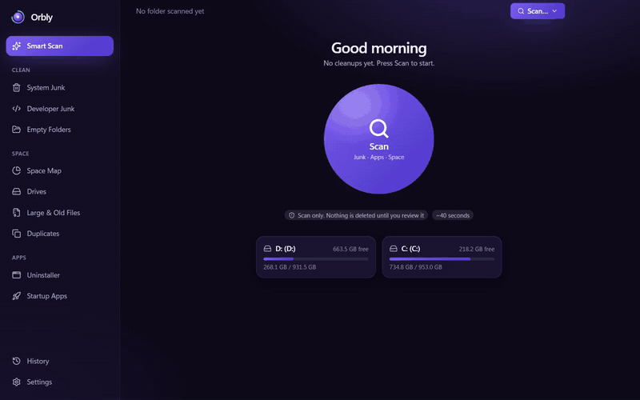

<a href="assets/demo/orbly-demo.mp4">Watch the full-quality video (MP4, 40 s)</a>

## Screenshots

Real captures of the app scanning a sample folder and this author's own PC (names of personal files removed).

<table>
<tr><td width="50%">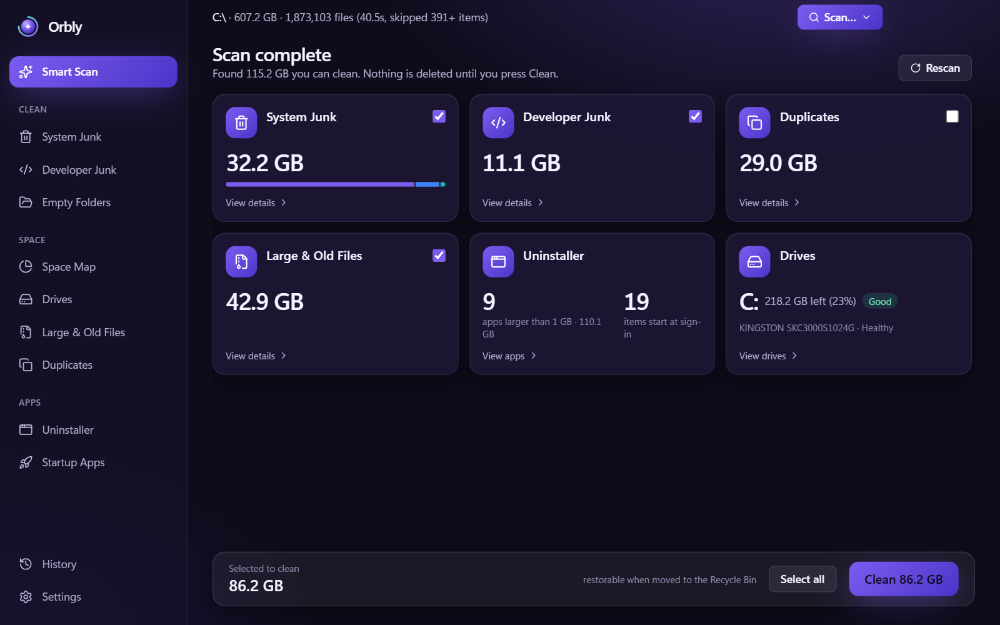 Smart Scan results</td><td width="50%">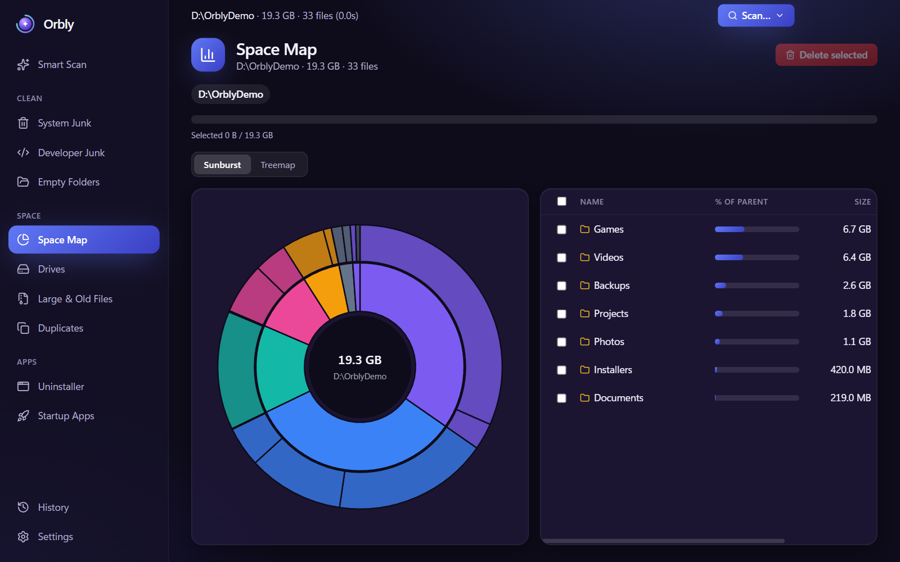 Space Map</td></tr>
<tr><td>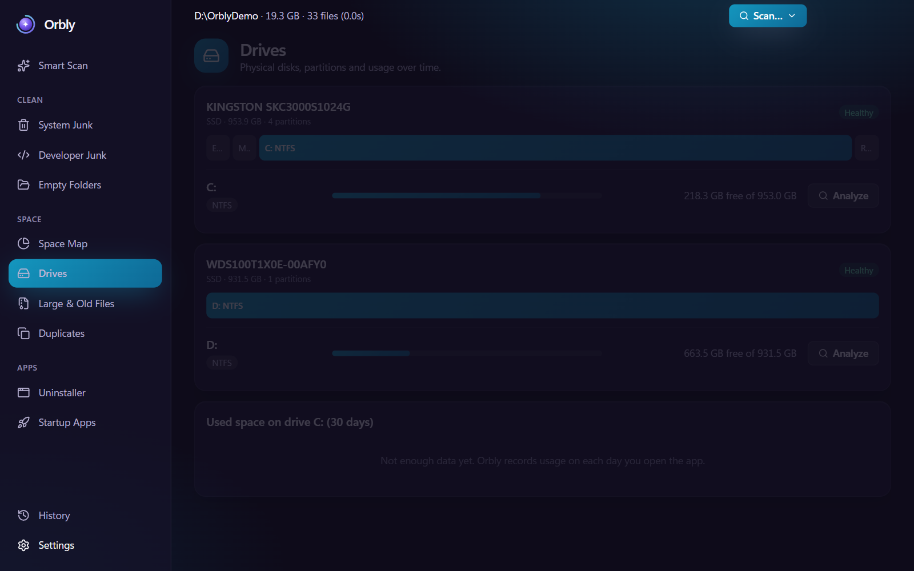 Drives</td><td>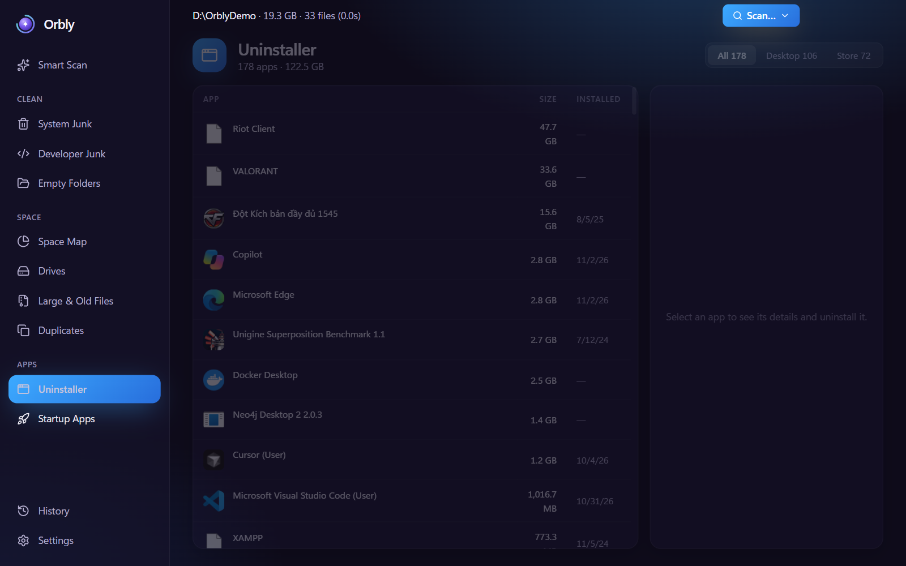 Uninstaller</td></tr>
<tr><td>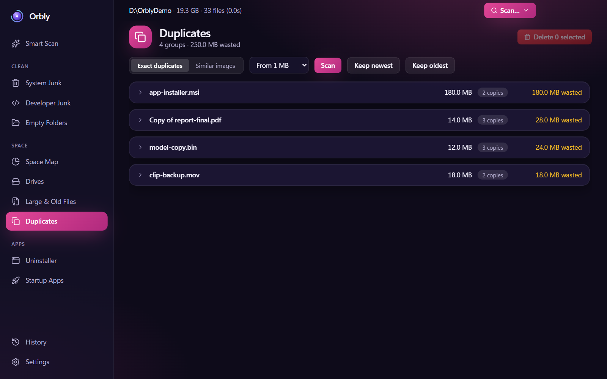 Duplicates</td><td>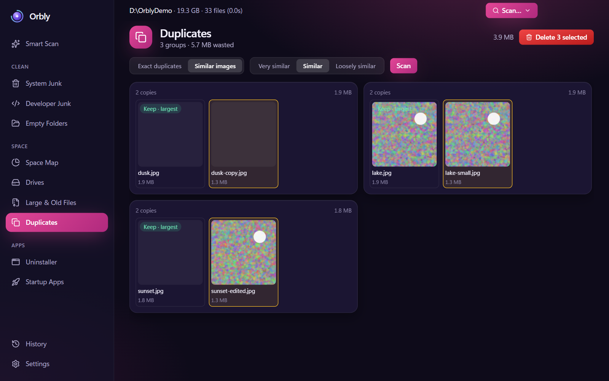 Similar images</td></tr>
<tr><td>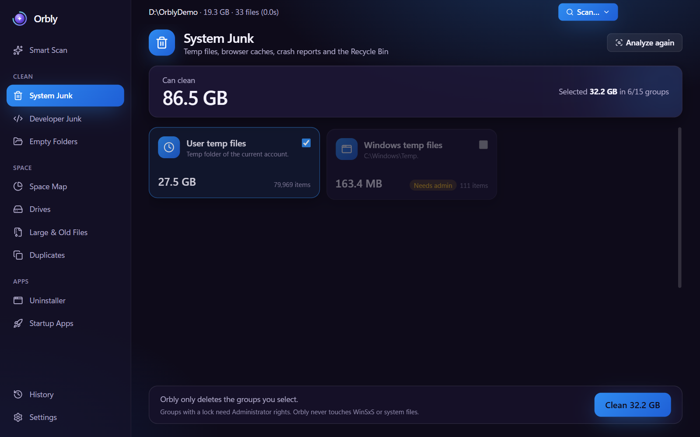 System Junk</td><td>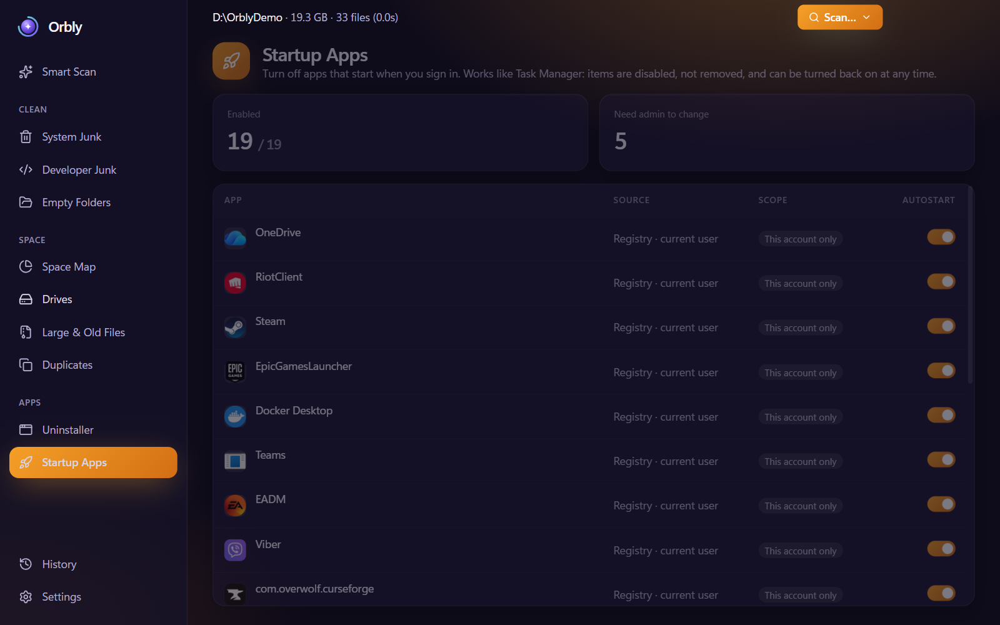 Startup Apps</td></tr>
</table>

More screenshots

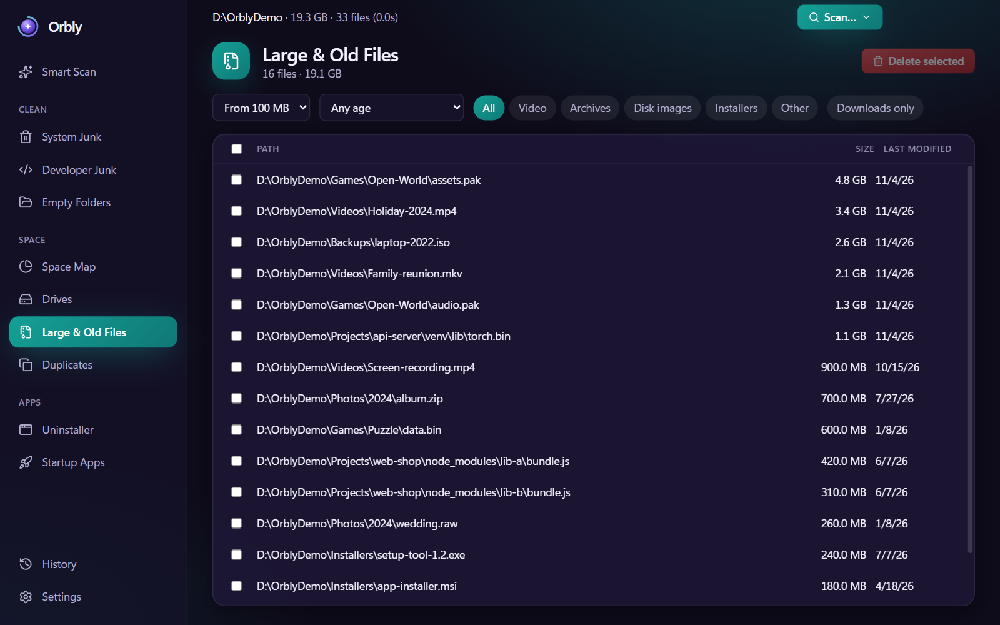 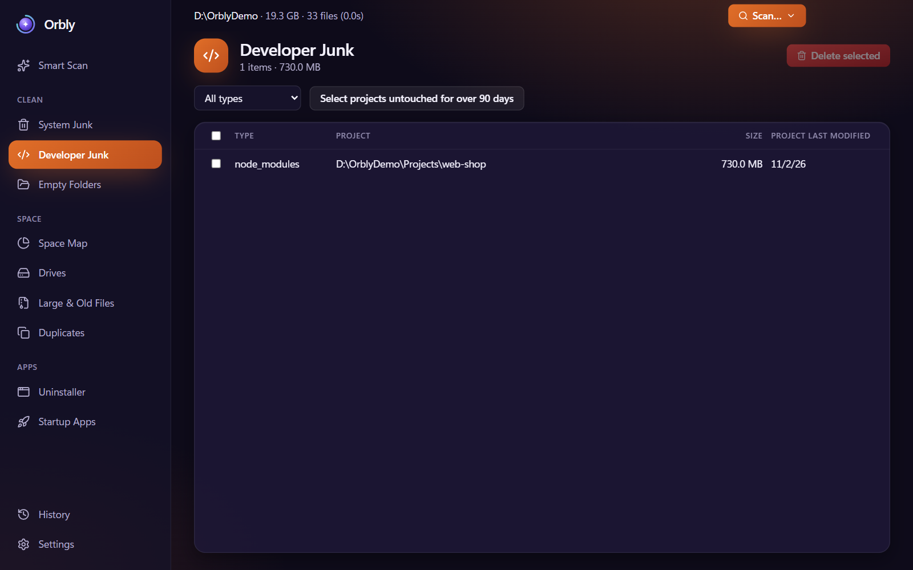
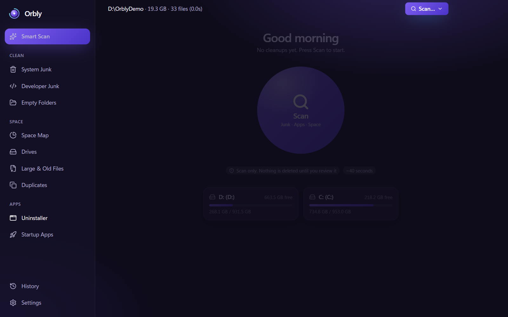 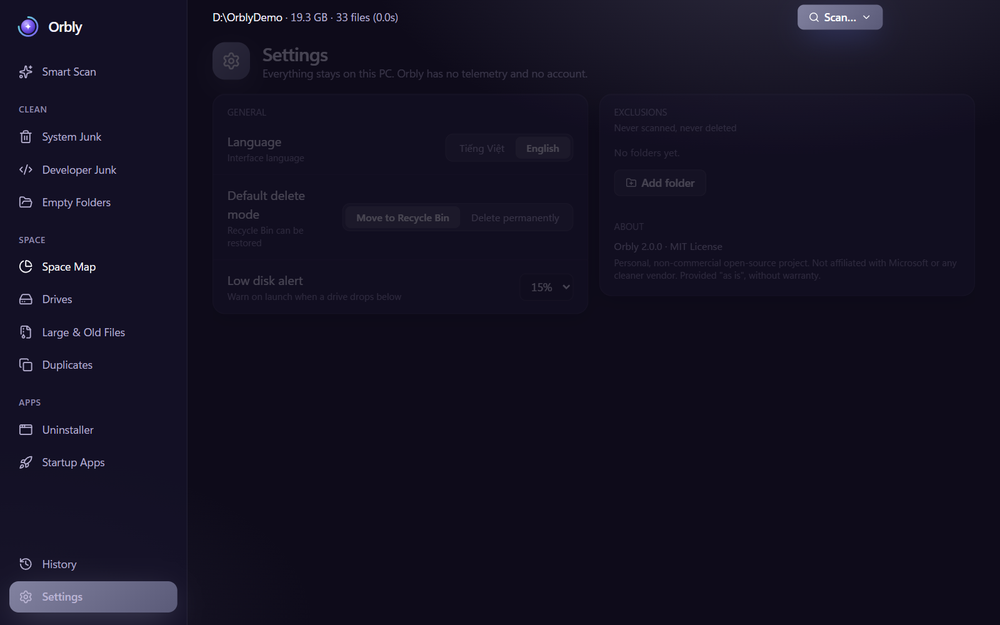

## Safety

- The UI never sends a file path to delete or run. The main process only accepts a `nodeId` from scan results, a junk group id from a fixed list, or an app, startup or leftover id it handed out itself, and looks up the path on its own.
- System paths cannot be deleted: drive roots, `C:\Windows`, `Program Files`, `ProgramData`, the user profile and its direct children such as `Documents` and `Downloads`.
- Folders you add under Settings > Exclusions are never scanned and never deleted. A parent folder of an exclusion cannot be deleted either, so the excluded folder stays safe.
- Delete mode defaults to the Recycle Bin, so files can be restored. Permanent delete needs an extra confirmation.
- The uninstaller starts the application's own uninstaller. Leftover folders are deleted only after you review and confirm them, and folders that may hold your data are flagged and unchecked. A folder that contains another installed app is never offered.
- Orbly never touches WinSxS or other Windows system files.
- Junctions and symlinks are not followed.
- Sizes shown are logical file sizes, not space used on disk.
- Groups that need Administrator rights (Windows Temp, Prefetch, Windows Update, Delivery Optimization, WER) are locked when the app runs without them. The packaged app has a "Relaunch as Admin" button.

## Privacy

No telemetry, no network calls, no account. Settings, history and drive usage samples are stored on your PC in `%APPDATA%\orbly`.

## Install

Download the latest installer from [GitHub Releases](https://github.com/LTK-Dev/orbly/releases).

The installer is not code-signed, so Windows SmartScreen may show an "Unknown publisher" warning. Choose _More info_, then _Run anyway_.

## Disclaimer

- The software is provided "AS IS", without warranty of any kind.
- Orbly deletes files. Review what you select before cleaning and keep backups of anything important. The author is not liable for data loss.
- Orbly is not affiliated with, endorsed by, or connected to Microsoft or any other cleaner vendor.
- Windows and other product names are trademarks of their owners and are used only to describe compatibility.
- The project is not sold and is not used for commercial purposes.

## License

Free to use. The source code is not published. © 2026 Kiet Le (LTK-Dev)
