[English](README.md) · **Tiếng Việt**

# Orbly

Ứng dụng dọn dẹp ổ đĩa Windows miễn phí. Quét một lần, xem lại mọi thứ, rồi mới dọn.

  
  
  
  

## Giới thiệu

Orbly là dự án cá nhân phi thương mại, làm vì sở thích và phát hành miễn phí. Logo, biểu tượng và giao diện do tác giả tự thiết kế và viết từ đầu. Repo này chỉ chứa phần giới thiệu sản phẩm. Mã nguồn không được công khai.

## Tính năng

| Tính năng              | Chức năng                                                                                                                                       |
| ---------------------- | ----------------------------------------------------------------------------------------------------------------------------------------------- |
| Quét thông minh        | Một lần quét gồm rác hệ thống, rác lập trình, file trùng, bộ cài cũ, ứng dụng và ổ đĩa. Xem các ô kết quả rồi bấm một nút Dọn                   |
| Bản đồ dung lượng      | Biểu đồ sunburst và treemap của ổ đĩa hoặc thư mục bất kỳ, kèm bảng chi tiết để xoá trực tiếp                                                   |
| Ổ đĩa                  | Ổ vật lý, thanh phân vùng, tình trạng, biểu đồ dùng 30 ngày và cảnh báo ổ đầy khi mở app                                                        |
| Rác hệ thống           | 15 nhóm: Temp, Prefetch, Windows Update, Delivery Optimization, cache Chrome/Edge/Firefox, cache ứng dụng, crash dump, WER, npm, pip, Thùng rác |
| Rác lập trình          | `node_modules`, `__pycache__`, venv, `bin`/`obj` .NET, `target` Rust, `.gradle`, cache framework                                                |
| File lớn & cũ          | Lọc theo dung lượng, tuổi file và loại file, có công tắc chỉ xét thư mục Downloads                                                              |
| File trùng lặp         | Trùng chính xác (size, băm 64 KiB đầu, rồi SHA-256) và ảnh giống nhau (băm cảm nhận)                                                            |
| Gỡ cài đặt             | Chạy trình gỡ của chính ứng dụng, sau đó liệt kê thư mục còn sót để bạn xem lại                                                                 |
| Khởi động cùng Windows | Bật hoặc tắt mục khởi động, giống cách Task Manager làm                                                                                         |
| Thư mục rỗng           | Thư mục không chứa file nào                                                                                                                     |
| Lịch sử                | Mỗi lần dọn đều được ghi lại, có lối tắt mở Thùng rác                                                                                           |
| Cài đặt                | Tiếng Việt hoặc English, cách xoá mặc định, ngưỡng cảnh báo ổ đầy, thư mục loại trừ                                                             |

## Demo

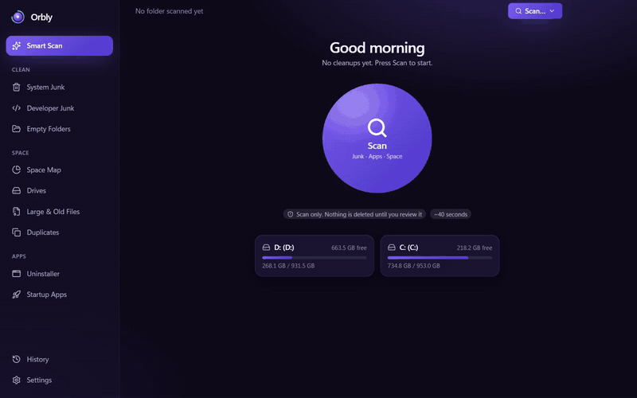

<a href="assets/demo/orbly-demo.mp4">Xem video chất lượng đầy đủ (MP4, 40 giây)</a>

## Ảnh chụp

Ảnh chụp thật khi app quét một thư mục mẫu và máy của tác giả (đã loại bỏ tên file cá nhân).

<table>
<tr><td width="50%">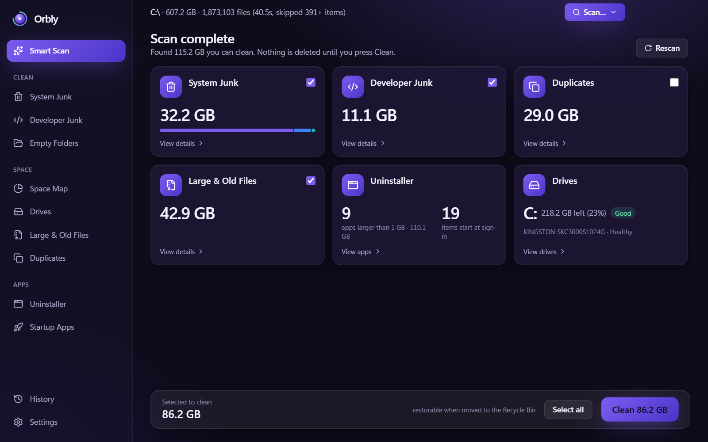 Kết quả Quét thông minh</td><td width="50%">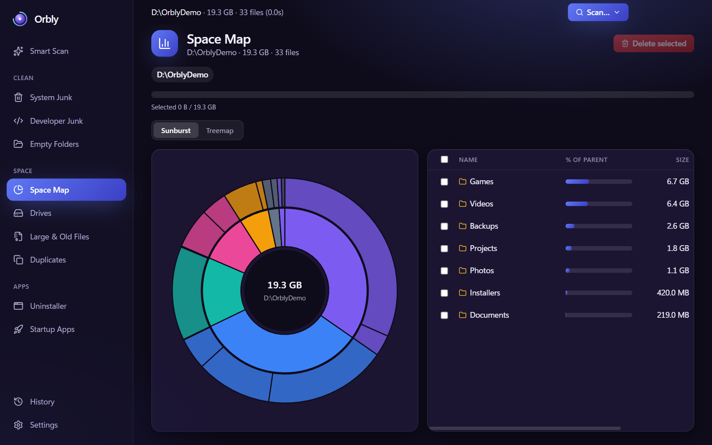 Bản đồ dung lượng</td></tr>
<tr><td>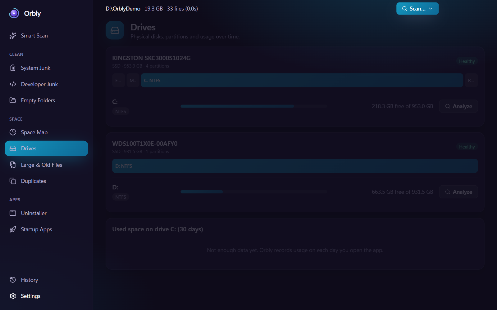 Ổ đĩa</td><td>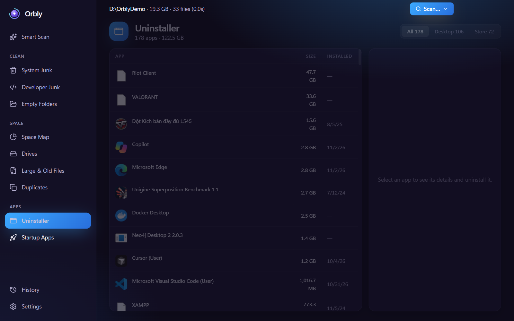 Gỡ cài đặt</td></tr>
<tr><td>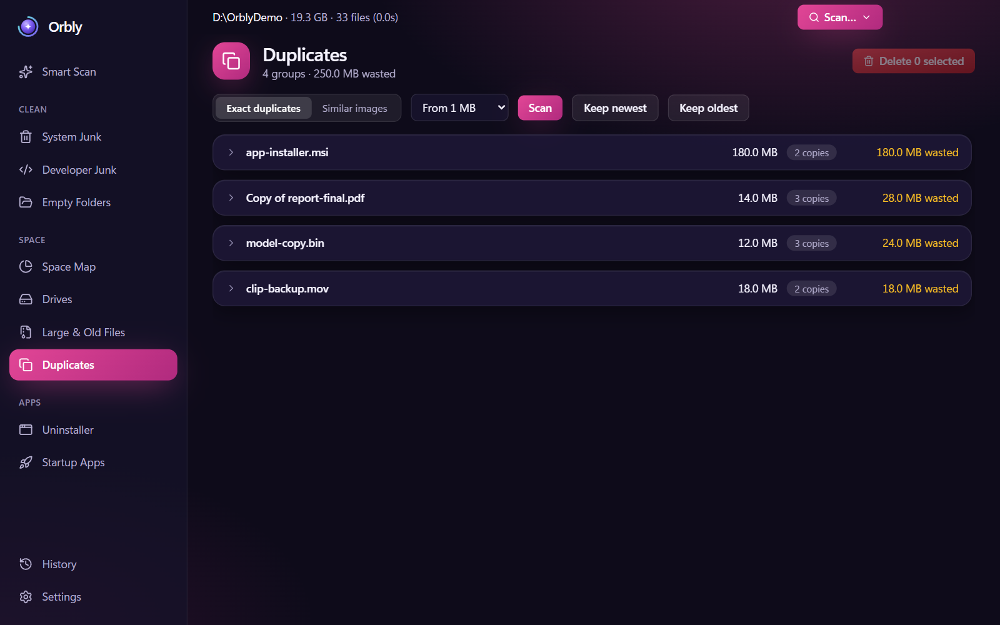 File trùng lặp</td><td>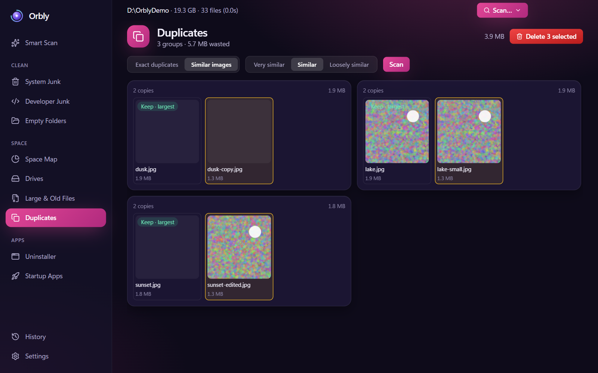 Ảnh giống nhau</td></tr>
<tr><td>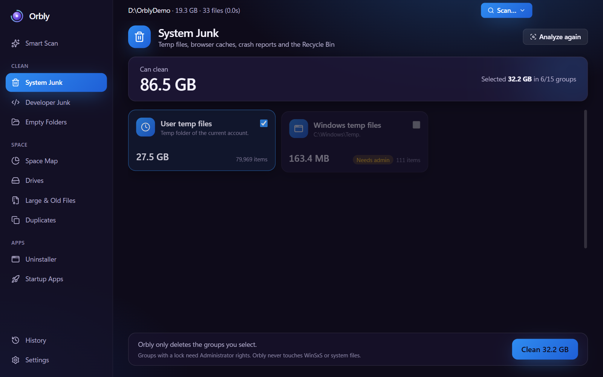 Rác hệ thống</td><td>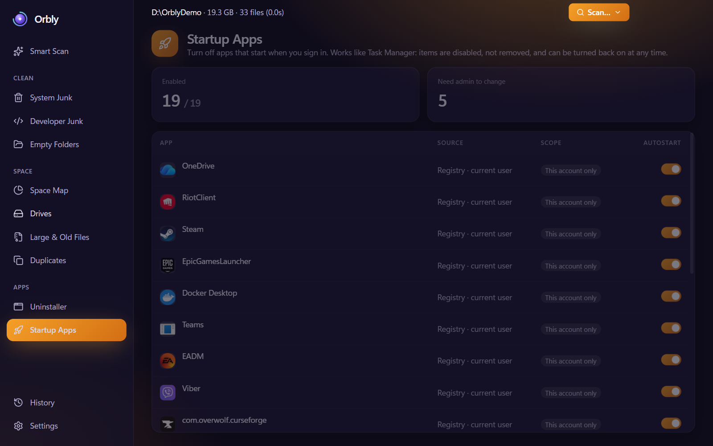 Khởi động cùng Windows</td></tr>
</table>

Thêm ảnh chụp

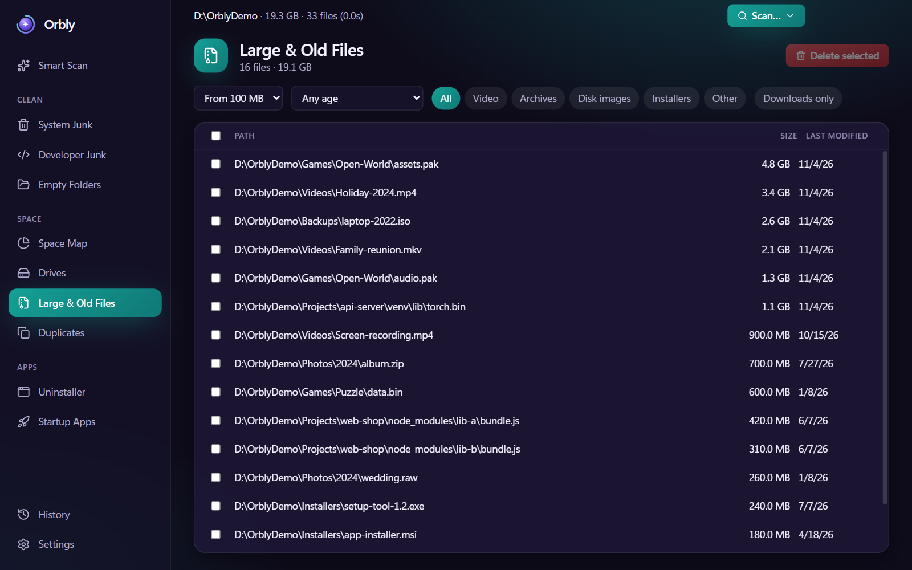 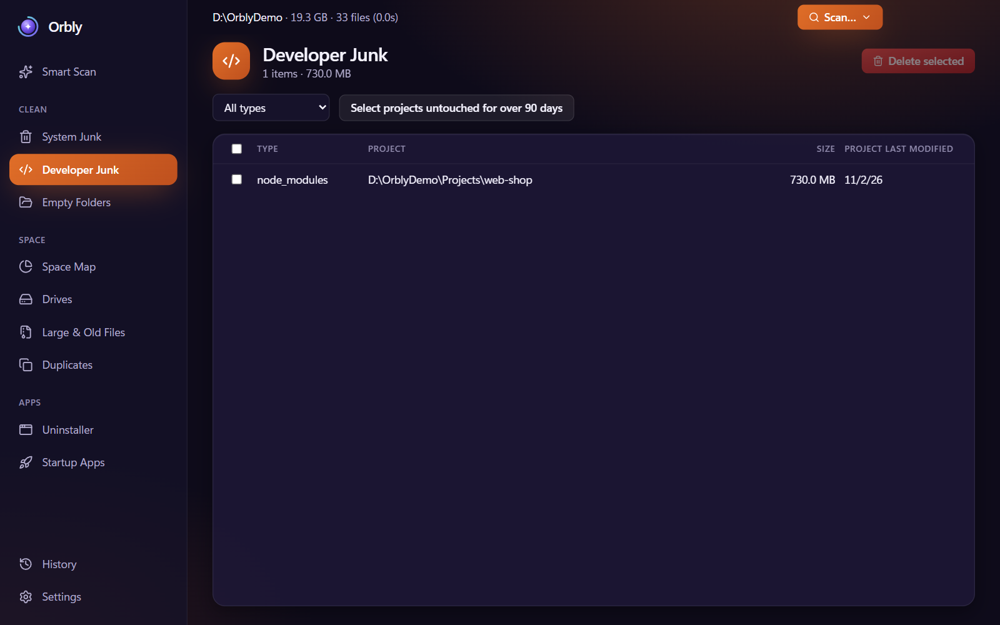
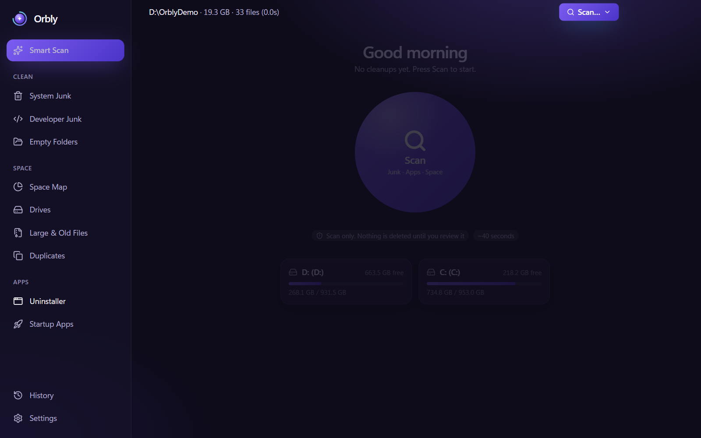 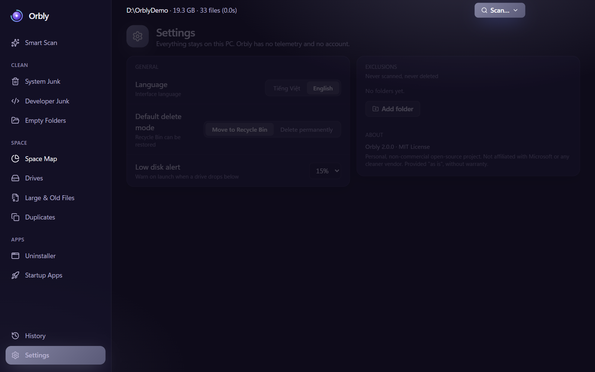

## An toàn

- Giao diện không bao giờ gửi đường dẫn để xoá hay chạy. Tiến trình chính chỉ nhận `nodeId` từ kết quả quét, id nhóm rác nằm trong danh sách cố định, hoặc id ứng dụng, mục khởi động, thư mục còn sót do chính nó cấp, rồi tự tra ra đường dẫn.
- Các đường dẫn hệ thống bị chặn xoá: gốc ổ đĩa, `C:\Windows`, `Program Files`, `ProgramData`, thư mục hồ sơ người dùng và các thư mục con trực tiếp như `Documents`, `Downloads`.
- Thư mục bạn thêm trong Cài đặt > Loại trừ không bao giờ bị quét và không bao giờ bị xoá. Thư mục cha của một mục loại trừ cũng không xoá được, nên thư mục được loại trừ luôn an toàn.
- Cách xoá mặc định là chuyển vào Thùng rác nên có thể khôi phục. Xoá vĩnh viễn cần xác nhận thêm.
- Trình gỡ cài đặt chạy chính trình gỡ của ứng dụng. Thư mục còn sót chỉ bị xoá sau khi bạn xem lại và xác nhận. Thư mục có thể chứa dữ liệu của bạn được đánh dấu và để bỏ chọn sẵn. Thư mục chứa một ứng dụng khác đang cài sẽ không bao giờ được đề xuất xoá.
- Orbly không bao giờ đụng vào WinSxS hay các file hệ thống khác của Windows.
- Liên kết thư mục (junction/symlink) không được đi theo.
- Dung lượng hiển thị là dung lượng logic của file, không phải dung lượng chiếm trên đĩa.
- Các nhóm cần quyền Administrator (Windows Temp, Prefetch, Windows Update, Delivery Optimization, WER) bị khoá khi app chạy quyền thường. Bản đã đóng gói có nút "Chạy lại với quyền Admin".

## Quyền riêng tư

Không telemetry, không gọi mạng, không cần tài khoản. Cài đặt, lịch sử và số liệu dung lượng ổ đĩa được lưu trên máy bạn trong `%APPDATA%\orbly`.

## Cài đặt

Tải bộ cài mới nhất tại [GitHub Releases](https://github.com/LTK-Dev/orbly/releases).

Bộ cài chưa được ký số, nên Windows SmartScreen có thể hiện cảnh báo "Unknown publisher". Chọn _More info_ rồi _Run anyway_.

## Miễn trừ trách nhiệm

- Phần mềm được cung cấp "NGUYÊN TRẠNG", không kèm bất kỳ bảo hành nào.
- Orbly xoá file. Hãy xem lại những gì bạn chọn trước khi dọn và sao lưu dữ liệu quan trọng. Tác giả không chịu trách nhiệm về việc mất dữ liệu.
- Orbly không liên kết, không được bảo trợ và không có quan hệ với Microsoft hay bất kỳ hãng phần mềm dọn dẹp nào khác.
- Windows và các tên sản phẩm khác là nhãn hiệu của chủ sở hữu và chỉ được dùng để mô tả khả năng tương thích.
- Dự án không bán và không dùng cho mục đích thương mại.

## Giấy phép

Miễn phí sử dụng. Mã nguồn không được công khai. © 2026 Kiet Le (LTK-Dev)
